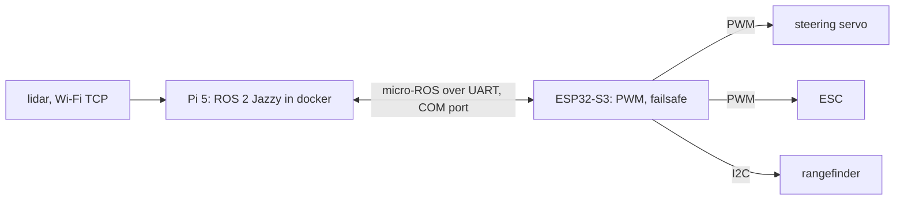

# racecar

A 1:10 Tamiya TT-02 made into a self-driving research platform. A Raspberry Pi 5 runs perception, sensor fusion, SLAM and racing-line planning. An ESP32-S3 does the hard-real-time control. This repo holds everything that runs on the car and the boards and tools to build it. Setup: [docs/setup.md](docs/setup.md). All docs: [docs/README.md](docs/README.md).

## Layout

| Folder | Content | Start here |
| --- | --- | --- |
| [`ros2_ws/`](ros2_ws/README.md) | ROS 2 Jazzy workspace that runs on the Pi: supervisor, ESP32 bridge, drivers, tools | [`ros2_ws/src/`](ros2_ws/src/) |
| [`firmware/`](firmware/README.md) | ESP32-S3 firmware: PWM, failsafe, rangefinder, micro-ROS link | [`firmware/esp32/`](firmware/esp32/) |
| [`pcb/`](pcb/README.md) | KiCad 10 projects of the power distribution board | [`pcb/src/`](pcb/src/) (active mill board) |
| [`simulation/`](simulation/README.md) | Gazebo simulation (scaffold; today in [racecar-sim](https://github.com/gvo27/racecar-sim)) | [`docs/interfaces/`](docs/interfaces/sensor_contract.md) |
| [`mechanical/`](mechanical/README.md) | 3D-printed mounts (scaffold) | - |
| [`models/`](models/README.md) | ML model manifest (weights are not in git) | [`models/manifest.yaml`](models/manifest.yaml) |
| [`docs/`](docs/README.md) | Setup, hardware, interfaces, decisions, plans, status | [`docs/setup.md`](docs/setup.md) |
| `deploy/`, `docker/`, `scripts/` | Car stack (compose, udev, systemd), docker images, session scripts | [`deploy/car/compose.yaml`](deploy/car/compose.yaml) |

## Daily commands

`make help` lists all targets. One-time setup, sensors and repairs: [docs/setup.md](docs/setup.md#10-command-reference).

| Command | Task |
| --- | --- |
| `make open` / `make close` | Start / end a Claude Code session (git sync, dev tools, plugins, report of open work) |
| `make car-up` | Start the car stack (micro-ROS agent, supervisor, lidar driver). Safe to run again |
| `make car-ps` | Wait until each service is `healthy`. Then switch the ESC on |
| `make teleop` | Drive over SSH (arrows, space = brake, `x` = disarm + quit) |
| `make car-logs` | Follow the logs when something looks wrong |
| `make rangefinder`, `make viz` | Live rangefinder feed; lidar scan, map and pose on `localhost:8765` |
| `make car-shutdown` | Disarm, stop the stack, offer to power off the Pi. Then switch the ESC off |

## Compute stack



| Layer | Hardware | Role | Status |
| --- | --- | --- | --- |
| High level | Raspberry Pi 5 | ROS 2 Jazzy in Docker (`deploy/car/`): supervisor, ESP32 bridge, micro-ROS agent, lidar driver. Sends `DriveCmd` (heading, throttle) | [rangefinder](docs/rangefinder/README.md), [lidar](docs/lidar/README.md) |
| Real time | ESP32-S3-N16R8 | Hardware PWM to servo and ESC, failsafe, telemetry. micro-ROS client over UART0 | [firmware](docs/firmware/README.md) |

Parts, wiring and power rules: [docs/hardware.md](docs/hardware.md). Rules for every change: [docs/invariants.md](docs/invariants.md).

## Microcontroller pinout

Left header P1 only. Source of truth: [`firmware/esp32/include/pins.h`](firmware/esp32/include/pins.h). Keep this section identical to it.

```
                ESP32-S3-N16R8   (top view, antenna up)
          P1 (LEFT header)
        ┌─────┬──────────────────────────────┐
  3V3   │  1  │ unused (sensors: own rail)   │
  3V3   │  2  │ unused                       │
  RST   │  3  │ ✗ do not use                 │
  GPIO4 │  4  │ ● STEER_PWM   → servo signal │
  GPIO5 │  5  │ ● THROTTLE_PWM→ ESC signal   │
  GPIO6 │  6  │ ○ BATT_LOW                   │
  GPIO7 │  7  │ ○ IMU_INT                    │
  GPIO15│  8  │ ○ ENC_A                      │
  GPIO16│  9  │ ○ ENC_B                      │
  GPIO17│ 10  │ · spare (UART1 TX)           │
  GPIO18│ 11  │ · spare (UART1 RX)           │
  GPIO8 │ 12  │ ● I2C SDA → rangefinder 3    │
  GPIO3 │ 13  │ ✗ strapping                  │
  GPIO46│ 14  │ ✗ strapping                  │
  GPIO9 │ 15  │ ● I2C SCL → rangefinder 4    │
  GPIO10│ 16  │ · spare                      │
  GPIO11│ 17  │ · spare                      │
  GPIO12│ 18  │ · spare                      │
  GPIO13│ 19  │ · spare                      │
  GPIO14│ 20  │ · spare                      │
  5V    │ 21  │ input only - leave unwired   │
  G     │ 22  │ ■ COMMON GROUND (ESC/servo)  │
        └─────┴──────────────────────────────┘
          [USB] left        [COM] right ← flash / host
   ● active   ○ reserved (no code yet)   · spare   ✗ do not use   ■ ground
```

| P1 # | GPIO | Function | Status |
| --- | --- | --- | --- |
| 4 | 4 | **STEER_PWM** → DS3225 signal | **active** |
| 5 | 5 | **THROTTLE_PWM** → ESC signal | **active** |
| 6 | 6 | *BATT_LOW* (hi/low input) | *reserved* |
| 7 | 7 | *IMU_INT* | *reserved* |
| 8 / 9 | 15 / 16 | *ENC_A / ENC_B* (shaft encoder) | *reserved* |
| 12 / 15 | 8 / 9 | **I2C SDA / SCL** → rangefinder (Garmin pin 3 / 4) | **active** |
| 10, 11, 16-20 | 17, 18, 10, 11, 12-14 | spare | spare |
| 3, 13, 14 | RST, 3, 46 | ~~reset / strapping pins~~ | ~~do not use~~ |
| 22 | G | common ground | power |

Wire colours: signal = yellow/white, power = red, ground = black. Rangefinder I2C: SDA = white, SCL = green. Put a tape flag on the two active signal wires.
