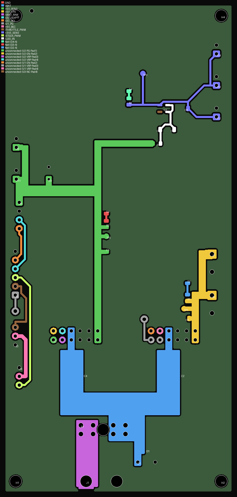
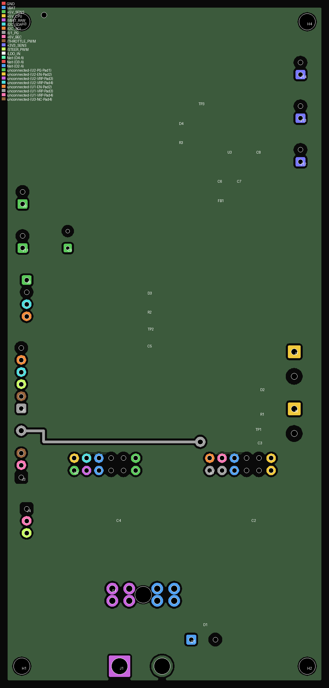

# Rev A power board: Fable final review (2026-11-15)

Scope: the schematic, the parts, the board, the milling limits and the fab outputs of `docs/schematics/`, on branch `pcb-agent` (stacked on `schematic`). The review used the new agents (`.claude/agents/pcb-designer.md`, `pcb-worker.md`, `pcb-reviewer.md`) and skills (`pcb-lab-config`, `pcb-parts`, `pcb-design-check`, `pcb-milling-check`).

Method: three independent reviewer runs (schematic and parts, board and milling and fab outputs, kicad-happy analyzers). The lead agent checked each finding in the raw files. Two worker runs made the fixes. The lead agent ran every check again. A fourth reviewer run checked the fix diff.

**Result: no blocker found.** The nets, the pin maps and the fab files agree with the datasheet notes and with the board. The review found one false statement in the review record, one false statement in the part data, two weak checks and several risks that need an owner decision or a lab tech answer before milling. The agents cannot say that the board is ready to mill: the owner and the lab tech decide that.

## 1. Owner feedback necessary

Values that are `assumed` in the lab file (`docs/schematics/milling.toml`) and change a result:

| Value | Assumed | Who confirms |
| --- | --- | --- |
| `milled_hole_min` | 3.3 mm (end mill 3.175 mm + 0.125 mm) | lab tech |
| `via_pad` | 2.1 mm | lab tech |
| `annular_min` | 0.45 mm | lab tech |
| `track_min` | 0.5 mm | lab tech |
| `edge_clearance` | 0.5 mm | lab tech |
| `connector_edge_distance` | 1.0 mm | owner |
| Isolation bit angle | Fusion "taper 30": 30 or 60 degrees included. The check uses the two readings | lab tech, or the Win11 tool library export |

Decisions and answers that the review needs (details in section 3):

1. **Bare copper (owner).** Lacquer or an insulating sheet on B.Cu, standoffs of 5 mm or more, Kapton tape on F.Cu under U1 and U2, modules only on headers.
2. **Floating copper (lab tech).** Add a pocket operation for the copper pieces that the isolation contours leave, or accept them.
3. **CAM frame (lab tech).** Import `B_Cu.dxf` in the same model frame as `F_Cu.dxf`. Cut the outline last or leave tabs.
4. **Brown-out at low pack voltage (owner).** U1 needs about 6.0 V in for 5 A. Policy: `VBAT` sense to the ESP32, or a throttle limit when `U1_PG` goes low.
5. **C9 part (owner).** All fields are `TBD`. It is the only part with no MPN.
6. **USB-C pigtails for J6 and J7 (owner).** Part and CC termination. Bench check.
7. **Optional schematic additions for rev A or rev B (owner):** I2C pull-up pads, PWM pull-down pads, a capacitor on `+6V_BEC` at J4, test points for GND, `VBAT` and `+6V_BEC`, GND rivets beside the `U1_PG` jumper vias, module retention.
8. The open questions of `../README.md` stay open (pin orientation, `U1_PG` jumper, J1 pad size, F1 peg).

## 2. Checks (lead agent, this session, KiCad 10.0.8 in the pinned image)

| Check | Result |
| --- | --- |
| `make pcb-test` | 131 tests, OK (119 before the review: 12 new tests for the path-width check) |
| `make erc` | 0 errors, 3 warnings (`lib_symbol_mismatch` D2 to D4, owner GUI step) |
| `make pcb-check` | DRC 0 errors, 16 warnings (`lib_footprint_mismatch`, intended), 0 unconnected items, parity clean. `check_board`: 0 problems |
| `make pcb-mill-check` | 0 errors, 0 waived, 0 questions, 0 gap-bit areas, 2 warnings (`MILL-SLIVER` at U3, known) |
| `make pcb-fab` | Files unchanged (no diff). `test_fab`: 21 tests, OK |
| `make bom` | `bom.csv` changes only in the U1, U2 comment. Total 94.02 USD, 14.12 USD without parts in hand |
| `pytest deploy/tests/test_claude_agents.py deploy/tests/test_rules_paths.py` (uv `.venv`) | 56 passed |
| kicad-happy 2.3.2 analyzers | Run on the current files. Triage in section 4 |
| SPICE | Not run: `ngspice` is not installed |

Copper width along the current paths (`make pcb-check`, opening test with no exemption):

| Row | Need (mm) | Measured (mm) |
| --- | --- | --- |
| GND trunk J1 - pour at U1 | 6.0 | 8.00 or more |
| GND entrance U1 | 1.6 | 4.81 |
| GND entrance U2 (the whole path from J1.2, through the U1 GND pad block) | 1.6 | 4.81 |
| GND J6/J7 - U1 | 1.6 | 4.07 |
| GND U2 output - J8/J9/J11/C9 | 1.6 | 1.64 |
| `VBAT_RAW` J1 - F1 | 6.0 | 6.18 |
| `VBAT` trunk F1 - prongs | 6.0 | 6.39 |
| `VBAT` neck U2 VIN | 1.6 | 1.88 |
| `VBAT` neck U1 VIN | 1.6 | 1.88 |
| `+5V_CPU` load path | 1.6 | 1.99 |
| `+5V_SENS` load path | 1.6 | 1.67 |
| `+5V_CPU` all pads | 0.5 | 1.17 |
| `+5V_SENS` all pads | 0.5 | 1.00 |
| `+6V_BEC` J3 - J4 | 1.0 | 1.00 |

## 3. Findings

### Fixed in this review

| # | Finding | Evidence | Fix |
| --- | --- | --- | --- |
| F1 | The path-width check hid the `VBAT` necks. The record said "`VBAT` 6.0 mm need, 6.39 mm". The copper from each prong to the module VIN pads is a neck 1.9 mm wide and about 6.9 mm long | `check_board.py` counted all copper within 2.5 mm of each narrow pad (`STUB_MM`). Reviewer measurement 1.89 mm, check now 1.88 mm | The exemption is removed. The rows are split into trunks (6.0 mm) and module entrances (1.6 mm, one module's current). The record table is corrected. The necks are acceptable for the load (at most about 5.1 A). See R1 for the fault case |
| F2 | The same exemption made the GND "7.41 mm" and the 5 V "1.99 / 1.79 mm" figures. Without it: 4.81 mm at the module GND pad block, 1.17 and 1.00 mm on branches to small parts | Lead measurement with stub 0 | New rows measure the load paths (5 V: 1.99 and 1.67 mm) and the small-part branches against the Default width |
| F3 | The path-width check passed with nothing to check (unknown net, missing pads) | `check_board.py` returned no problem for an empty group | The check fails for a net with no copper, a missing pad and an empty list. Tests added |
| F4 | `+6V_BEC` (servo, up to 3 A) had no width row | - | Row added: 1.00 mm against 1.0 mm (Power3A) |
| F5 | "About 7.4 A at 6 V in" for the Pololu D36V50F5 is not on the graph. The Vout = 5 V curve starts at about 6.6 V in | `docs/datasheets/pololu_d36v50f5_max_current.png` | Corrected in the datasheet note, the schematic note and fields, the board fields, `bom.csv` and five documents: about 7.4 A at 6.6 V in, about 7.7 A at 8.4 V in, no data below 6.6 V |
| F6 | The dropout flag was only on U2. U1 has the same dropout and feeds the Pi | Dropout graph: about 1.0 V at 5 A | Flag and bench check added (log `VBAT` at J1 and `+5V_CPU` at J6 under throttle with the pack near 6.5 V). Owner question 4 |
| F7 | MILL-GAP used a bit that the lab CAM does not use (60 degrees, 0.1 mm tip: 0.192 mm cut) | Lab `.f3z`: only the 0.2 mm tip tool | The bit moved from the limits to the inventory. MILL-GAP now needs 0.243 mm (0.292 mm for the second angle reading). The smallest gap on the board is 0.35 mm (U3) |
| F8 | The two USB-C pigtails (J6, J7) were in no BOM | `bom_offboard.csv` | Two rows added, `TBD`, with the bench checks |
| F9 | U3 budget "0.3 A, about 0.5 W" is too hot for SOT-25 (about +105 K with theta JA 184 C/W, Diodes datasheet, not archived in the repo) | (5.2 - 3.3) V x 0.3 A = 0.57 W | Flag in `design_overview.md` and the plan: 0.15 A or less until U3 has more copper or the load is measured. Known loads are about 0.07 A |
| F10 | Document errors: 13 and 16 `lib_footprint_mismatch` warnings in one file, J6 and J7 named in the list, `U1_PG` jumper "about 75 mm" (39.3 mm measured), old part counts not marked as old | DRC output, board file | Corrected |
| F11 | A 90 MB Python core dump was in the repo (`core.1` in this project directory, from commit b2e856e) | `file` output | Removed from the tree, `core` files are in `.gitignore`. The file stays in the git history of `schematic` |

### Open risks (owner or lab tech decision)

| # | Risk | Evidence | Proposal |
| --- | --- | --- | --- |
| R1 | The copper rule says: size `VBAT` and GND copper for the fuse rating (16.5 A). The module entrances cannot meet it: the pad pitch limits the `VBAT` necks to 1.88 mm and the GND pad block to 4.81 mm | Rows above | Accept: each entrance carries one module's current. A short at a module input must open F1 through a 1.88 mm neck. Owner decision |
| R2 | Bare copper on the two faces. B.Cu `VBAT_RAW` is before the fuse and faces the chassis. The F.Cu GND pour is about 0.74 mm under the parts on the module underside (1.8 mm parts, 2.54 mm spacer: check the real spacer) | `fab_handoff.md`, datasheet note | Section 1, item 1 |
| R3 | Isolation contours leave floating copper: about 75 pieces and 37 mm2 on B.Cu, the largest about 17 mm2 near the left edge between GND, `+6V_BEC` and the PWM nets. A solder blob can bridge pad, channel, piece, channel, pad | Reviewer script on the board fills, cut width 0.2437 mm | Section 1, item 2. Notes in `../../fab/README.md` |
| R4 | Setup C mirrors the board if `B_Cu.dxf` goes on a bottom-face sketch. An outline cut in Setup B frees the board before the flip. Dowel play (4.191 mm hole, 4.0 mm pin) permits about 0.19 mm shift between the faces | `../../example/README.md`, `../../fab/README.md` | Section 1, item 3 |
| R5 | Brown-out: near the 6.0 V cutoff, or when the ESC pulls the pack down, `+5V_CPU` can fall. C1 gives about 26 us of hold-up | Dropout graph, 470 uF x 0.5 V / 9 A | Section 1, item 4. Bench check |
| R6 | I2C at 400 kHz with only the 13 kohm pull-ups of the rangefinder: the rise time may be about 600 ns against the 300 ns limit (estimate with 55 pF, not measured) | `firmware/esp32/src/main.cpp` bus speed, rangefinder note | Pads for two pull-ups to `+3V3_SENS` (not fitted), or 100 kHz, or a scope check |
| R7 | `THROTTLE_PWM` floats while the ESP32 is in reset. The ESC may not see a floating line as a lost signal | Schematic: no pull resistor | Pad for a 10 kohm pull-down (not fitted). Bench check with the ESC |
| R8 | `+6V_BEC` has no capacitor, test point or clamp at J4. The servo stall current is 2.3 A | Schematic | 100 to 220 uF, 10 V or more, at J4 |
| R9 | Vibration: U1, U2, C1 and the F1 holder hang on B-side solder joints of an unplated board. The module M2 holes (2.18 mm) cannot be made (the drill set stops at 2.0 mm, the smallest bored hole is 3.3 mm) | Lab file | Adhesive, or a 2.0 mm hole for M2 screws with play to be checked on the real module |
| R10 | The KiCad footprint text of the F1 holder says "PCB thickness up to 1.5 mm". The blank is 1.57 mm | Footprint description | Check the pin length and the peg on the real holder before milling |
| R11 | The schematic PDF `rc_power_board.pdf` has the old note text (owner GUI step: plot again). The `Value` fields of C1 to C6, D1, F1 and U3 show `TBD` although an MPN is proposed | `bom.md` "Open part choices" | Owner approves the MPNs, then the values change |

## 4. kicad-happy analyzers (2.3.2) on the current files

EMC score: 70 of 100 (the baseline board had 82). The lower score comes from findings that are false for this board (GP-001 on the I2C and PWM nets) and one new true finding (DC-001).

| Rule | Finding | Verdict |
| --- | --- | --- |
| DC-001 | C2 and C4 are about 10 mm from the module VIN pads | True as measured. The Pololu modules have their own input capacitors, and the rule is for bare ICs. Owner decision |
| GP-001 | I2C and PWM nets have 78 to 91 % reference plane cover | False positive: the gaps are the F.Cu pour openings around the THT pads at the track ends. True for `U1_PG` (slow status signal), accepted before |
| RP-001, VS-001 | `U1_PG` changes layer with no GND via near. One GND via on the F.Cu pour | True, same as the baseline. Section 1, item 7 |
| PS-002, RP-002 | `VBAT` and `+5V_SENS` "split in islands" | False positive: bus zones that overlap. 0 unconnected items |
| PU-001 | `U1.PG` and `U3.EN` "no pull-up" | False positive, as the baseline |
| DO-DET | U1, U2, U3 "no decoupling" | False positive: C2 to C8 are on the nets |
| TE-001 | No test point on GND, `VBAT`, `+6V_BEC` | Partly true. Section 1, item 7 |
| PM-002 | J1 and other parts near the edge | By design (connectors on the edge) |
| EP-AUD | J3, J4, J5, J8 have no ESD parts | True. Short harness inside the car. Owner decision |
| Thermal | U3 not assessed (no datasheet data in the cache) | See F9 |
| Fab gate | WARN: no revision text on the copper | True. A milled board has no silkscreen. Optional: copper text |

## 5. Verified

- Netlist export in the pinned image: 40 parts. Pin-to-net table against the datasheet notes and the crimp table for U1, U2, U3, D1 to D4, C1, C9 and J1 to J14: all agree.
- `Pololu_D36V50Fx` pad numbers against the Pololu drawing and pinout photo: correct in the top view. U3 on B.Cu: the pad map is the correct mirror.
- Fab outputs: a new export in a copy is byte-identical. The drill file agrees with an independent transform of the board holes: 76 holes and 2 dowels (0.8 x 2, 1.0 x 52, 1.1 x 3, 1.3 x 4, 1.4 x 8, 3.4 x 7). DXF copper area agrees with pcbnew.
- Smallest gap between nets: 0.35 mm (U3 only), all others 0.4 mm or more. No F.Cu copper touches a THT pad. Only GND copper is inside an M3 head radius of H1 to H4.
- Power budget recalculated: 9.63 A input at 6.0 V and 90 % efficiency, 64 % of F1. XH pin currents as the documents say (J3 and J4 pin 2 at 100 % of the rating).

## 6. Not verified

- Hardware: all bench checks, the 1:1 paper check, 3D collisions, connector latch and wire entry directions, the F1 holder on the real part.
- The Win11 Fusion exports (setup sheet, post-processed code, tool library) are not in the repo yet. The bit angle and the CAM order stay open until they arrive.
- Facts from the web that are not archived in the repo: AP2112K thermal data, Makera Carvera work area and spindle, Phoenix terminal rating.
- The rangefinder pull-up value and the JST XH pin rating come from repo notes only.
- SPICE (no `ngspice`), distributor stock and prices, part lifecycle.
