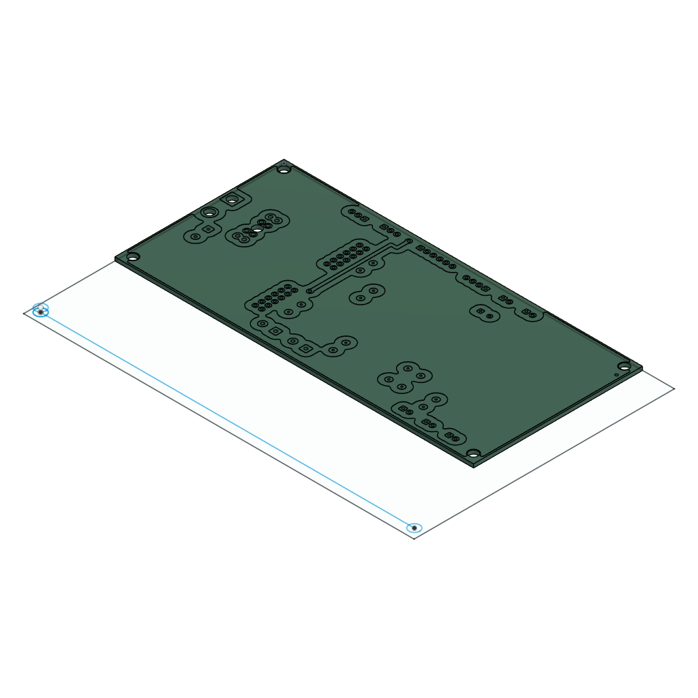

# Rev3 lab CAM file: `rc_power_board.f3d`

The lab tech made this Fusion 360 CAM file to mill the rev3 board (`pcb/src/rc_power_board.kicad_pcb`). The owner received it on 2026-11-25. The run from this file failed (log: [`../milling_findings.md`](../milling_findings.md), F-005). So this file is the CAM of a failed run, not a reference. Only the dowel frame is a lab standard: the same dowels serve every job on this machine (owner, 2026-11-25).

- `rc_power_board.f3d` in this folder is the lab file without the user path lines of its 7 CAM message logs (35 lines, the PC user name). All other members are byte for byte the original. Original sha256 `7593ef6aaffc2c39a0adc5f657b7041934ba875e051b4dbf642e01201091c6ce`. Not verified: that Fusion opens the cleaned file.
- Fusion CAM 2706.1.17. Toolpaths generated 2026-11-20. Machine: Makera Carvera 3-axis, post `user://Carvera.cps`, 6 tools, air coolant only.
- Status of each value: **read** = from the CAM XML (`theIronDoc.irondoc`) or the machine file. **decoded** = from the toolpath float data with a heuristic decoder. Decoded values agree with the XML where both exist.

## Model and flip

The board is not flipped in the Fusion model. Both copper layers sit on the board at their true positions. The second face is machined through a flipped setup frame, after the operator turns the real blank on the dowels.

| Item | Value | Status |
| --- | --- | --- |
| Model | Substrate z 0 to 1.43 mm. F.Cu body z 1.43 to 1.505 (top). B.Cu body z -0.075 to 0 (bottom face). Copper bodies 0.075 mm thick (KiCad 0.07 mm) | decoded (pocket floors, stock tops, drill depths) |
| B.Cu position | True board XY, not mirrored: the B.Cu toolpath, mapped back through the Setup3 frame, avoids every board pad (0 of 431 points in a pad). A mirrored B.Cu gives 15 points in pads | decoded |
| Board in the model | Model x = 180 - y_kicad, y = 60 - x_kicad (mm, KiCad y down): top view turned 90 degrees clockwise, outline x 0..140, y -66..0 | decoded (80 holes within 0.003 mm) |
| Setup5 (F.Cu) | Model orientation. WCS origin = sketch point at model (2.8766, -97.81, 1.57) | read |
| Setup3 (B.Cu) | `axesZY`, `flipZ`: Z points down into the bottom face, X reverses. WCS origin = sketch point at model (148.7234, -97.81, 0) | read |

## Dowel frame (lab standard)

| Item | Value | Status |
| --- | --- | --- |
| Dowel points | The two WCS origins. 145.8468 mm apart on one line (model y = -97.81), parallel to the board long side. Equal to `[dowel] centers` in `milling.toml` | read |
| Dowel hole | 4.2672 mm (the widened hole, F-001: owner 2026-11-25). This file does not bore the dowels | owner |
| Board to dowel 1 | Outline from -2.8766 to 137.1234 mm along the dowel line, 31.81 to 97.81 mm from it | read + decoded |
| Board on the blank | With dowel 1 at (3.2766, 3.81) of the blank: outline x 0.40..140.40, y 35.62..101.62. The board edge is at the far long edge of the 101.6 mm blank | decoded |
| Fab export frame | `placement.board_to_lab` turns the board 90 degrees counter-clockwise and centers it. The lab file differs by 180 degrees and an offset | decoded |

## Z frame

| Setup | Z0 | Stock top in the setup frame | Isolation floor | Cut if Z0 is probed on the board surface |
| --- | --- | --- | --- | --- |
| Setup5 | model z 1.57 | -0.065 mm | -0.14 mm | 0.14 mm deep |
| Setup3 | model z 0 (flipped) | +0.075 mm | 0.00 mm | 0.00 mm: no isolation |

The operator sets Z0 with the Carvera Z probe on the board surface (owner, 2026-11-25). The CAM expects Z0 at the sketch points. The two do not agree.

## Setups and operations (read)

| Setup | Operation | Tool | Data |
| --- | --- | --- | --- |
| Setup3 | 2D Offset Roughing1 (pocket) | T3 "6mm Flute Corn", flat 0.6 mm, 2 flutes, flute 6 mm, shank 3.175 mm | 12000 rpm, 300 mm/min, plunge 50, stepover 0.18, stepdown max 0.08, depth "from contour" |
| Setup3 | 2D Offset Roughing1 (2) (rest pocket after 0.6 mm) | T6 "EC-A2 002-003/005C4H45 IC702", flat 0.2 mm, 2 flutes, flute 0.3 mm, **shank 4 mm** | 5000 rpm, 1000 mm/min (0.1 mm/tooth), plunge 333, stepover 0.06 |
| Setup5 | 2D Offset Roughing2 (pocket, no rest pass) | T3 | as Roughing1 |
| Setup5 | Drill1, Drill2 | T4 drill 0.8 mm (16 holes), T4 drill 1.0 mm (52 holes) | 10000 rpm, plunge 100, chip-breaking, 0.4 mm through |
| Setup5 | Drill3 | T1 drill 1.1 mm (6 holes) | 12000 rpm, plunge 198, 0.5 mm through |
| Setup5 | Drill4 | T5 drill 1.4 mm (8 holes) | 12000 rpm, plunge 252, 0.5 mm through |
| Setup5 | Bore1 | T4 end mill 3.175 mm "12mm Flute End Mill Metal" | 12000 rpm, 500 mm/min, 0.05 mm below the hole bottom |

- Not used: T2 "0.1mm Tip Engraving Metal" (30 deg, tip 0.2) and T2 "0.2mm Tip Engraving Metal" (15 deg, tip 0.2). No V-bit pass. No board outline cut.
- T6 has a 4 mm shank. The Carvera collet takes 1/8 in (3.175 mm). The micro end mills on hand have a 3.175 mm shank (`[inventory.bits_on_hand]`).
- Flood coolant on T1, T5 and T6. The machine has air only.
- One NC program, "rc_car_power_board side A": only Setup3 Roughing1, marked invalid, no NC code. The `.cnc` files that ran are not in the file.
- Generation warnings: "Clamping helicalRampDiameter to minimumRampDiameter" (2 on each Setup3 pocket). No errors.

## Holes against the board (decoded)

| Board hole | Count | CAM |
| --- | --- | --- |
| 0.8 mm | 16 | Drill1 0.8 mm |
| 1.0 mm | 52 | Drill2 1.0 mm |
| 1.1 mm rivet vias | 3 | Drill3: 2 of 3. The via at KiCad (68.1, 42.1) is not drilled |
| 1.3 mm (J6, J7) | 4 | Drill3 1.1 mm: 0.2 mm under size |
| 1.4 mm | 8 | Drill4 1.4 mm |
| 3.4 mm (H1 to H4, F1 NPTH; J1) | 7 | Bore1 |

## How to read the file again

The `.f3d` is a zip with zstd members (method 93). Python 3.14 `zipfile` reads them: `uv run --no-project --python 3.14 python -I -c "import zipfile,sys; zipfile.ZipFile(sys.argv[1]).extractall(sys.argv[2])" <file.f3d> <empty dir>`. Extract to a scratch directory, not into the repo. The readable members: `Toolpath[Active]/Iron.Document/theIronDoc.irondoc` (CAM XML), `Iron.Machine/2.mch` (JSON), the message logs, the toolpath float data and the PNG previews. The model (BREP) data is not readable on Linux.
