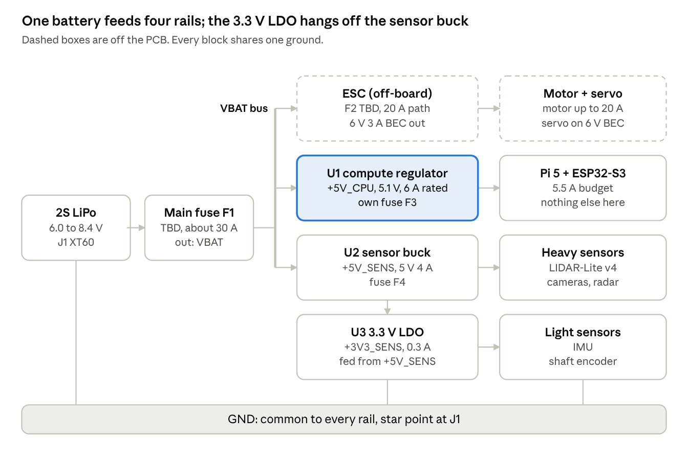

# KiCad Power Rail Schematic Guide — RC Car Platform

Exported 2026-10-28 from the live doc: https://claude.ai/artifact/G7oi8ZxQaXkXNUEQmDbfmX (edit there, re-export here). This file is the spec for the baseline schematic in this folder (`rc_power_board.kicad_sch`). Project KiCad version: 10.0.

## Overview

The goal is a first-draft KiCad schematic for one **power distribution board (PDB)** that takes the 2S LiPo and produces four rails, ready for a professional to critique. It is a draft: every part value you are unsure of is marked `TBD` so the reviewer sees exactly where your knowledge stops.

The board carries four power circuits, all sharing one ground:

| Rail (net name) | Voltage | Current budget | Made by | Feeds |
| --- | --- | --- | --- | --- |
| `VBAT` | 7.4 V nominal (6.0 to 8.4 V) | up to 20 A to the ESC, plus the other rails | battery, through the main fuse | ESC power input; inputs of the two switching regulators |
| `+5V_CPU` | 5.0 to 5.1 V | 5.5 A (regulator rated 6 A or more) | dedicated, higher-grade step-down regulator | Raspberry Pi 5, ESP32-S3 |
| `+5V_SENS` | 5.0 V | 3.3 A (buck rated 4 A, TBD) | buck converter | Garmin LIDAR-Lite v4, extra cameras, radar, and the 3.3 V LDO |
| `+3V3_SENS` | 3.3 V | 0.3 A (TBD) | low-noise LDO fed from `+5V_SENS` | IMU, shaft encoder, other light sensors |

The servo is powered by the ESC's built-in 6 V / 3 A output (its **BEC**, battery eliminator circuit), so it never touches this board's 5 V rails. Actuator signal lines (PWM from the ESP32, data to the Pi) are out of scope; the board only has to give every device power and a shared ground reference.



Everything hangs off one fused `VBAT` bus; each branch has its own fuse placeholder, and only the compute branch gets the higher-grade regulator.

**How the work flows.** You draw the schematic (a logical wiring diagram), assign each symbol a physical footprint, lay out the PCB (where copper actually goes), and export Gerber files that a fab house (JLCPCB, PCBWay, OSH Park) turns into a board. This guide gets you through the schematic in detail and sketches the later steps so you and the reviewer share vocabulary.

**What a good review draft contains:** a clean, readable schematic PDF; the KiCad project folder (zipped or in git); the power budget table below; and a list of open questions. Reviewers spend their time on design when the drawing itself is tidy, so the formatting section matters as much as the electrical one.

> **Repo note:** the KiCad project lives next to this file in `docs/schematics/`; see `README.md` there. The invariant "ESP32 powers nothing" from the project rules is what this board makes true.

## Electrical background for a first board

The one idea behind everything here: **copper has resistance, and current through resistance makes heat** (P = I² × R). At 20 A, a skinny trace becomes a fuse. Most of the rules below are ways of keeping that heat and the matching voltage drop small.

### Why a breadboard won't do

Breadboard contacts are rated around 1 A and loosen with vibration. At 20 A they melt, and in a moving car a loose contact causes brown-outs that reboot the Pi. A PCB gives you rated connectors, sized copper and soldered joints.

### Trace width and copper weight

A **trace** is a copper path on the PCB. Its current capacity depends on its cross-section: width (you choose it in layout) times thickness (you choose it when ordering). Thickness is sold as **copper weight**: 1 oz/ft² ≈ 35 µm (the default) and 2 oz ≈ 70 µm (a cheap upgrade at most fabs). Outer-layer traces cool better than inner ones.

The classic sizing rule is IPC-2221 (the newer, more accurate standard is IPC-2152, which reviewers may prefer). For an outer layer:

```latex
I = 0.048 \cdot \Delta T^{0.44} \cdot A^{0.725}
```

where I is current in amps, ΔT is the allowed temperature rise in °C, and A is the cross-section in mil² (1 mil = 0.0254 mm). KiCad has this built in: from the Project Manager, open **Calculator Tools → Track Width**. Widths for an outer layer from that formula:

| Current | 1 oz, +10 °C | 1 oz, +20 °C | 2 oz, +10 °C | 2 oz, +20 °C | Used for |
| --- | --- | --- | --- | --- | --- |
| 20 A | 18.7 mm | 12.3 mm | 9.4 mm | 6.1 mm | battery to ESC path |
| 8 A | 5.3 mm | 3.5 mm | 2.6 mm | 1.7 mm | `VBAT` feed to the three regulators |
| 5 A | 2.8 mm | 1.8 mm | 1.4 mm | 0.9 mm | `+5V_CPU` |
| 3 A | 1.4 mm | 0.9 mm | 0.7 mm | 0.4 mm | `+5V_SENS` |
| 1 A | 0.3 mm | 0.2 mm | 0.2 mm | 0.1 mm | `+3V3_SENS` |

Takeaways for this board:

- **20 A does not fit in a normal trace.** Use a **copper zone** (a filled polygon) on both layers, joined by many vias, with 2 oz copper. Some designers also leave the solder mask off the strip and add solder to thicken it.
- **Or keep 20 A off the board.** A common RC approach wires the battery straight to the ESC with 12 to 14 AWG silicone wire and taps a short, fused lead to the PDB for the electronics. Ask your reviewer which they prefer (open question 1).
- **Vias** (plated holes joining layers) carry roughly 1 A each for a standard 0.3 mm drill. A 20 A layer change needs 20 or more vias, or a larger drill.
- **Connectors and wire** must match the copper: XT60 for the battery (a common RC connector, about 30 A continuous), screw terminals or XT30 for 5 A outputs, and check every terminal's datasheet current rating.

**Cross-check with IPC-2152.** The table above uses the 1950s-based IPC-2221 formula. Its successor, IPC-2152, is more accurate from 5 to 25 A and usually asks for more copper on a lone trace:

| Current, 2 oz copper | IPC-2221, +10 °C | IPC-2152, +10 °C | IPC-2152, +20 °C |
| --- | --- | --- | --- |
| 20 A | 9.4 mm | 33 mm | 16 mm |
| 8 A | 2.6 mm | 6.3 mm | 3.2 mm |
| 5 A | 1.4 mm | 2.7 mm | 1.4 mm |
| 3 A | 0.7 mm | 1.1 mm | 0.6 mm |

IPC-2152 figures use the approximate formula from secondary sources (the full standard is paywalled). A solid copper plane close to the trace lowers its temperature a lot, so real boards land between the two columns. IPC-2152's test data stops at 25 A and this board's worst case is about 27 A, so the 20 A path is beyond what either formula covers well. That strengthens the case for keeping it on wire off the board (open question 1).

### Ground

All rails share one ground (`GND`) so signals between the Pi, ESP32 and sensors have a common reference. On the PCB, ground is usually one big copper zone on the bottom layer. The risk is that the motor's 20 A return current, which is noisy, flows under the sensors and shifts their ground by millivolts. The fix is layout: keep the ESC's ground path short and to one side, and join everything at a **star point** near the battery connector. In the schematic it is still one net called `GND`.

### Regulator, buck converter: what's the difference?

Both turn a higher voltage into a lower one. A **linear regulator** (LDO) burns the difference as heat: dropping 2.4 V at 5 A wastes 12 W, which is impossible on a small board. A **buck converter** (switching step-down regulator) switches on and off thousands of times a second and wastes only 5 to 15 %. So the two high-current rails use bucks; the "dedicated voltage regulator" for the compute rail means a higher-grade buck with more headroom, better transient response and its own fuse. The 3.3 V rail is the exception: its load is tiny (about 0.1 A), so an LDO fed from `+5V_SENS` wastes well under 0.5 W and gives far cleaner power than a buck. Chaining regulators this way costs almost nothing here because the efficiency loss only applies to the small 3.3 V load. Two things about bucks matter here:

- **Dropout.** A 2S LiPo sags to about 6.4 V near empty, leaving only 1.3 V of headroom above 5.1 V. The compute regulator must still hold 5.1 V at 5 A with 6.0 V in. Check the datasheet's minimum input voltage at full load.
- **Noise.** Switching makes ripple. IMUs are sensitive to it, which is why the 3.3 V rail is an LDO after the sensor buck; a ferrite-bead filter in front of the LDO may still help (open question 5).

### Fuses, flags and other protection

- **Fuse:** a sacrificial link that opens on overcurrent so a short burns the fuse, not the wiring or the battery. Size it above normal peak current and below what the copper and wire can carry. Placeholders here are `TBD`.
- **Bulk and decoupling capacitors:** a big electrolytic capacitor on `VBAT` absorbs the ESC's current spikes; small ceramic capacitors at each regulator's input and output keep it stable. Values come from each regulator's datasheet. Ceramic capacitors lose much of their capacitance under DC voltage ("DC bias"): a 22 µF 10 V part on a 5 V rail may act like 10 µF or less, so check its bias curve or choose a higher voltage rating.
- **TVS diode** (transient-voltage suppressor): clamps voltage spikes on `VBAT` caused by the motor. Its standoff voltage must be above 8.4 V.
- **Reverse-polarity protection:** the XT60 is keyed, but a hand-soldered pigtail can still be wired backwards. A P-channel MOSFET or ideal-diode controller on the regulator branch is cheap insurance.
- **Power LEDs and test points** on each rail let you see and probe what's alive during bring-up.

## Power budget

Worst case, the battery supplies about **27 A**: 20 A to the ESC plus about 7.3 A into the two switching regulators when the battery is nearly empty. That total, not just the ESC's 20 A, sets the main fuse, the battery connector and the `VBAT` copper. The 3.3 V rail is now a low-noise **LDO** fed from `+5V_SENS`, so its current is counted inside the sensor buck's load. Per-device figures marked "approx." are from memory and must be checked against each datasheet before the review.

| Rail | Load | Est. peak current | Notes |
| --- | --- | --- | --- |
| `+5V_CPU` | Raspberry Pi 5 | 3 A board alone (approx.), 5 A with USB devices | Official supply is 5.1 V / 5 A |
| `+5V_CPU` | ESP32-S3-N16R8 dev board | 0.5 A (approx., Wi-Fi bursts) | Stays here, see below |
| `+5V_CPU` | **Rail total** | **5.5 A** | Rate U1 at 6 A or more |
| `+5V_SENS` | Garmin LIDAR-Lite v4 LED | 0.1 A (approx.) | 5 V supply, 3.3 V logic |
| `+5V_SENS` | Extra cameras (USB, via powered hub) | 0.3 to 0.5 A each (approx.) | Cameras plugged directly into the Pi draw from `+5V_CPU`, not here |
| `+5V_SENS` | Radar | TBD | Model not chosen |
| `+5V_SENS` | 3.3 V LDO input | 0.3 A | An LDO draws the same current it delivers |
| `+5V_SENS` | **Rail total** | **3.3 A (TBD)** | Pick a buck rated 4 A |
| `+3V3_SENS` | IMU | < 0.02 A (approx.) | Noise-sensitive; the reason for the LDO |
| `+3V3_SENS` | Shaft encoder | < 0.05 A (approx.) |  |
| `+3V3_SENS` | **Rail total** | **0.3 A (TBD)** | LDO heat at 0.3 A: (5 − 3.3) × 0.3 ≈ 0.5 W |
| ESC BEC (off-board) | DS3225MG servo | 2.3 A stall at 6.8 V (datasheet) | Fed by the ESC's 6 V / 3 A output |
| `VBAT` | ESC + motor | 20 A | Peaks may exceed this briefly |
| `VBAT` | Two regulators' inputs | 7.3 A at 6.4 V in | U1 4.4 A + U2 2.9 A, at 90 % efficiency |
| `VBAT` | **Battery total** | **about 27 A** | Main fuse TBD, likely 30 A class |
|  |  |  |  |

**Why the ESP32 stays on `+5V_CPU` rather than moving to 3.3 V.** It would free at most about 0.5 A of the Pi's budget, and only during Wi-Fi bursts; idle it draws closer to 0.1 A. The costs outweigh that. Its radio bursts would put noise on the IMU's clean rail. The LDO would have to grow to about 1 A and shed about 1.7 W of heat. Feeding a dev board's 3V3 pin bypasses its own regulator and fights it when USB is plugged in. And the ESP32 controls the throttle, so it belongs with the protected compute rail, not the sensor rail. Rating U1 at 6 A buys more margin than moving the ESP32 would.

How the regulator input currents were worked out (do this yourself for each rail):

```latex
I_{in} = \frac{V_{out} \cdot I_{out}}{\eta \cdot V_{in,min}} = \frac{5.1 \cdot 5}{0.90 \cdot 6.4} \approx 4.4\ \text{A}
```

where η is the regulator's efficiency and V\_in,min is the lowest battery voltage you expect. The lowest battery voltage gives the highest input current, so it is the worst case.

## Install KiCad and create the project

KiCad is free, open-source and what most hobby and many professional reviewers use. Menu names below match KiCad 8 and 9; newer versions move little.

1. Download from [kicad.org/download](https://www.kicad.org/download/) and install with the default options, which include the standard symbol and footprint libraries (a few GB).
2. Start KiCad. The first window is the **Project Manager**: a file list on the left and big buttons on the right for each tool.
3. If asked about library tables on first launch, choose **Copy default global symbol library table** (and the same for footprints).
4. **File → New Project…**, pick a folder such as `Documents/kicad/rc_power_board`, keep **Create a new folder for the project** ticked, and name it `rc_power_board`.
5. KiCad creates three files: `rc_power_board.kicad_pro` (settings), `.kicad_sch` (schematic) and `.kicad_pcb` (board). All are plain text, so they work well in git.

### The tools you will use

| Tool (Project Manager button) | What it is for | When |
| --- | --- | --- |
| Schematic Editor | Draw the logical circuit: symbols and wires | Now |
| Symbol Editor | Make a symbol KiCad doesn't have (your buck modules) | Now |
| PCB Editor | Place footprints and draw copper | After the schematic is reviewed |
| Footprint Editor | Make a footprint KiCad doesn't have | Later, if needed |
| Calculator Tools | Track width, via current, resistor dividers | Whenever you size copper |
| Gerber Viewer | Check the files you send to the fab | Before ordering |
|  |  |  |

### Moving around the Schematic Editor

Open the schematic by double-clicking `rc_power_board.kicad_sch`. KiCad is keyboard-driven: hover the mouse where you want something, then press the key. Press **Esc** to cancel any tool.

| Key | Action |
| --- | --- |
| Scroll wheel | Zoom; hold the middle button to pan |
| Home | Zoom to fit the whole sheet |
| A | Add a symbol (part) |
| P | Add a power symbol (`GND`, `+5V`, `PWR_FLAG`) |
| W | Draw a wire; click to bend, double-click to end |
| L | Add a net label (names a wire) |
| Q | Mark a pin as intentionally unconnected |
| M / G | Move / drag (G keeps wires attached) |
| R, X, Y | Rotate, mirror horizontally, mirror vertically |
| E | Edit the properties of the item under the mouse |
| T | Add text (for notes) |
| Ctrl+Z / Ctrl+S | Undo / save (save often) |
| ? | Show every hotkey |

All of these also exist in the **Place** menu and the right-hand toolbar, so you can click instead if you forget a key.

## Draw the schematic, step by step

You will build one A3 sheet split into five labelled regions, with power flowing left to right. Work in this order and save after each step.

### Step 1: page settings

1. **File → Page Settings…**
2. Paper size: **A3**, landscape.
3. Fill the title block: Title `RC Car Power Distribution Board`, Revision `A (draft)`, Date (today), Company (your name), Comment 1 `Draft for review, values marked TBD are unconfirmed`.
4. Click **OK**. These fields print in the bottom-right corner on every PDF.

### Step 2: block out the regions

1. **Place → Add Rectangle** (or the rectangle button on the right toolbar). Drag five boxes across the sheet, left to right: **A Battery input**, **B ESC and servo**, **C Compute 5 V**, **D Sensor 5 V**, **E Sensor 3.3 V**. Put a sixth, smaller box at the bottom for **Notes**.
2. Press **T** inside each box's top edge and type its title in a larger text size (E → Text Size ≈ 2.5 mm).
3. These boxes are drawings only; they don't connect anything. They tell a reviewer where to look.

### Step 3: make one symbol for the regulator modules

KiCad has no symbol for a ready-made buck module, so you will make a simple 4-pin one and reuse it three times. For a first draft, **modules** (small pre-built regulator boards soldered onto your PCB with pin headers) are far easier than designing a regulator from a bare IC; your reviewer may later swap one or more for a chip-level design.

1. In the Project Manager, open the **Symbol Editor**.
2. **File → New Library…**, choose **Project** (keeps it with this design), name it `rc_power`.
3. Select `rc_power` in the left list, then **File → New Symbol…**. Name `REG_MODULE`, default reference designator `U`, click **OK**.
4. Press **P** to add a pin. Make four, one at a time:

| Pin number | Pin name | Electrical type | Side |
| --- | --- | --- | --- |
| 1 | VIN | Power input | left |
| 2 | GND | Power input | bottom |
| 3 | VOUT | Power output | right |
| 4 | EN | Input | left |

5. Draw a rectangle body between the pins (rectangle tool on the right toolbar). Keep pins on the 1.27 mm (50 mil) grid, the default, or wires won't snap to them.
6. **File → Save**. Close the Symbol Editor.

The **electrical type** matters: "Power output" on VOUT tells KiCad's checker that this pin drives the rail, so the checker won't complain that the rail has no source.

### Step 4: understand net names before placing anything

A **net** is everything electrically joined. KiCad joins things three ways: a wire, a **net label** with the same name, or a **power symbol** with the same name. That last one is the trap: every `+5V` power symbol on the sheet is the same net. If you put `+5V` on both 5 V rails, KiCad shorts the compute rail to the sensor rail.

So give every rail its own name. How depends on your KiCad version (**Help → About KiCad** shows it):

- **KiCad 8 or newer:** press **P**, choose `power:VCC`, place it, then press **E** and change **Value** to the rail name. From version 8 the Value sets the net name. Place a fresh symbol from the library each time rather than copy-pasting a renamed one.
- **KiCad 7 or older:** editing Value only changes the text on screen. The net is still named after the symbol's hidden pin, so every renamed `power:VCC` stays one net called `VCC`. Instead, put a **net label** (**L**) named `VBAT`, `+5V_CPU`, `+5V_SENS` or `+3V3_SENS` on the wire, or make a project power symbol in the Symbol Editor whose pin name is the rail name.

Either way, use the standard `power:GND` for ground everywhere, and never `GNDA`, `GNDD` or `GNDPWR`: those are separate nets and would break the common ground.

**Always check, in any version:** click a wire on each rail and read its net name in the **message panel** at the bottom of the window. `+5V_CPU` and `+5V_SENS` must show different names, and none of the rails may show `VCC`. A merged rail looks perfect on screen but ties the battery straight to every regulator output.

### Step 5: region A, battery input

Press **A**, type the symbol name in the search box, pick it, click to place. Then press **E** on each part to set its **Value** and later its **Footprint**.

1. Place `Connector_Generic:Conn_01x02` as **J1**, value `XT60 battery`. Pin 1 is +, pin 2 is −.
2. Place `Device:Fuse` as **F1**, value `TBD (main, about 30 A)`. Wire J1 pin 1 to one end of F1 with **W**.
3. Press **L** on the wire between J1 and F1 and name it `VBAT_RAW` (the unfused side). Put a `VBAT` power symbol on the other side of F1.
4. Place `Device:D_TVS` as **D1**, value `TVS TBD, standoff ≥ 9 V`, from `VBAT` to `GND`, cathode (the bar) toward `VBAT`.
5. Place `Device:C_Polarized` as **C1**, value `TBD µF, ≥ 16 V, low ESR`, from `VBAT` to `GND`, + toward `VBAT`. This is the bulk capacitor.
6. Put `power:GND` on J1 pin 2.
7. Press **P**, choose `power:PWR_FLAG`, and put one on the `VBAT_RAW` wire and one on the `GND` wire near J1. A **PWR\_FLAG** tells the checker "power enters here", because a connector pin can't prove that on its own. A flag does not pass through a fuse or ferrite bead, so after the later steps also add one on `VIN_CPU`, `VIN_SENS` and `LDO_IN` (each feeds a regulator's power input), and on `VBAT` and `+6V_BEC`. Without them the checker reports "input power pin not driven" on U1, U2 and U3.

### Step 6: region B, ESC and servo

1. **J2** `Connector_Generic:Conn_01x02`, value `ESC power`, pin 1 to `VBAT` through **F2** (`Device:Fuse`, value `TBD, ESC branch`), pin 2 to `GND`. If the reviewer prefers the 20 A path off-board, J2 and F2 are deleted later.
2. **J3** `Connector_Generic:Conn_01x03`, value `ESC receiver lead (BEC in)`. The ESC's 3-wire lead carries the throttle signal *into* the ESC and the 6 V BEC power *out*. Pin 1 `GND`, pin 2 net label `+6V_BEC`, pin 3 net label `THROTTLE_PWM`.
3. **J4** `Connector_Generic:Conn_01x03`, value `Servo DS3225MG`. Pin 1 `GND`, pin 2 `+6V_BEC`, pin 3 `STEER_PWM`.
4. **J5** `Connector_Generic:Conn_01x03`, value `Actuator signals to ESP32`. Pin 1 `THROTTLE_PWM` (GPIO5), pin 2 `STEER_PWM` (GPIO4), pin 3 `GND`. The signals themselves are handled by the firmware; this header just gives them a home.
5. Add a text note: `+6V_BEC comes only from the ESC. Never connect to any 5 V rail.`

### Step 7: region C, compute 5 V

1. **F3** `Device:Fuse`, value `TBD`, from `VBAT` to the regulator input.
2. Optional: **Q1** reverse-polarity protection. Leave a text placeholder `Reverse polarity protection TBD (P-FET or ideal diode)` if you aren't sure.
3. **U1** `rc_power:REG_MODULE`, value `5.1 V buck rated ≥ 6 A, TBD (Vin min ≤ 6.0 V at 5 A)`. VIN from F3, GND to `GND`, VOUT to a `+5V_CPU` power symbol.
4. EN pin: wire it the way the module's datasheet says (often tied to VIN or left open). Until you know, press **Q** on it to mark it unconnected and add a note `EN per datasheet, TBD`.
5. **C2** `Device:C`, value `TBD µF, ≥ 16 V` at VIN to `GND`; **C3** `Device:C`, value `TBD µF, ≥ 10 V` at VOUT to `GND`.
6. Power LED: **R1** `Device:R`, value `1k5` (about 2 mA), in series with **D2** `Device:LED`, from `+5V_CPU` to `GND`, LED cathode toward `GND`.
7. **TP1** `Connector:TestPoint` on `+5V_CPU`.
8. **J6** `Connector_Generic:Conn_01x02`, value `Raspberry Pi 5 power`, and **J7** `Connector_Generic:Conn_01x02`, value `ESP32-S3 5 V`. Pin 1 `+5V_CPU`, pin 2 `GND` on each.

### Step 8: region D, sensor 5 V

Same pattern as region C:

1. **F4** fuse `TBD`, **U2** `REG_MODULE` value `5 V buck rated 4 A, TBD`, input cap **C4**, output cap **C5**.
2. VOUT to a `+5V_SENS` power symbol. LED **R2** + **D3**, test point **TP2**.
3. Output headers, each `Conn_01x02` (pin 1 `+5V_SENS`, pin 2 `GND`): **J8** `LIDAR-Lite v4`, **J9** `Camera USB hub`, **J10** `Radar`, **J11** `Spare 5 V`.
4. `+5V_SENS` also feeds the 3.3 V LDO in region E. A net with the same name joins them; no wire across the sheet is needed.

### Step 9: region E, sensor 3.3 V

The 3.3 V rail is a **linear regulator (LDO)** fed from `+5V_SENS`, not a buck from the battery. KiCad has real symbols for common LDOs, so you don't need the custom `REG_MODULE` here.

1. Put a `+5V_SENS` power symbol at the left of region E. That is the LDO's supply; no separate fuse is needed because F4 already protects this branch.
2. Optional noise filter: **FB1** `Device:FerriteBead` in series from `+5V_SENS` to the LDO input, plus **C6** `Device:C` to `GND`, values `TBD`. Leave it in so the reviewer can decide.
3. **U3**: press **A**, search `AP2112K-3.3` (a common 600 mA low-noise LDO, symbol `Regulator_Linear:AP2112K-3.3`) or search `LDO 3.3` and pick a similar one. Value `3.3 V LDO ≥ 300 mA, TBD`. Wire VIN to the filter output (or straight to `+5V_SENS`), GND to `GND`, VOUT to a `+3V3_SENS` power symbol. If it has an EN pin, tie it to VIN unless the datasheet says otherwise.
4. **C7** at the LDO input and **C8** at its output, `Device:C`, values from its datasheet (often 1 µF ceramic each). LDOs can oscillate with the wrong output capacitor, so follow the datasheet exactly.
5. LED **R3** + **D4**, value `680R` for a 3.3 V rail, test point **TP3**.
6. Output headers: **J12** `IMU`, **J13** `Shaft encoder`, **J14** `Spare 3.3 V`.
7. Note: the ESP32's own 3V3 pin must not power these sensors (project rule: the ESP32 powers nothing), and the ESP32 itself stays on `+5V_CPU`.

### Step 10: notes box

In the Notes region, press **T** and add numbered assumptions, for example:

1. Battery: 2S LiPo, 6.0 to 8.4 V, XT60.
2. All fuses and protection values TBD; positions are proposals.
3. Single common `GND`; star point at J1 in layout.
4. `+6V_BEC` is ESC-supplied and isolated from the 5 V rails.
5. Signals are 3.3 V logic or lower.

### Step 11: number the parts and check

1. **Tools → Annotate Schematic… → Annotate.** This replaces any `U?` or `C?` with real numbers. If you numbered by hand as above, it leaves yours alone.
2. **Inspect → Electrical Rules Checker → Run ERC.** Fix every error; for each warning, either fix it or understand why it's harmless. The usual beginner errors are "input power pin not driven" (missing PWR\_FLAG) and "pin not connected" (missing wire or **Q** marker).
3. Click an error in the list and KiCad jumps to it on the sheet.

## Formatting a schematic a reviewer can read

A schematic is read like a page of text: left to right, top to bottom. These conventions are what an experienced engineer expects; breaking them won't stop the board working, but it slows the review.

- **Power flows left to right.** Inputs (battery, connectors in) on the left, outputs on the right.
- **Higher voltage on top, ground at the bottom.** Supply symbols point up, `GND` symbols point down.
- **No four-way wire crossings.** Where four wires meet, KiCad may or may not join them, and a reader can't tell. Use two T-junctions offset slightly instead. A dot means connected; a crossing without a dot means not connected.
- **Labels instead of long wires.** If a wire would cross half the sheet, end it with a net label or power symbol and pick it up again where needed.
- **Every part has a reference and a value.** References follow standard prefixes: J connector, F fuse, U regulator or IC, C capacitor, R resistor, D diode or LED, Q transistor, FB ferrite bead, TP test point.
- **Values say what matters.** A capacitor value includes its voltage rating (`22µF 16V`); a fuse includes its current (`TBD 5A`). Anything unconfirmed says `TBD`, following the project rule of no unconfirmed parameters.
- **Text stays readable.** Don't let labels overlap wires or symbols. Use **View → Show Hidden Pins** off and the default 1.27 mm grid on.
- **Net names are consistent.** Capitals, `+` for positive rails, voltage then purpose: `+5V_CPU`, `+5V_SENS`, `+3V3_SENS`. Write `3V3` rather than `3.3V` because dots can confuse some tools.
- **One sheet is fine here.** KiCad supports **hierarchical sheets** (one sub-sheet per rail, joined by hierarchical labels), which large designs need. For about 40 parts, one A3 sheet with region boxes is easier for you and the reviewer.

### Handing the draft to the reviewer

1. **File → Plot… → PDF**, colour, all pages. This is what most reviewers mark up.
2. Zip the whole project folder, or put it in git. Add `*-backups/`, `*.lck`, `fp-info-cache` and `*.kicad_prl` to `.gitignore`; those are local caches.
3. Send the PDF, the project, the power budget and the open questions (the last section) together.
4. After each review round, bump the title block revision (A, B, C…) and keep the old PDF so changes are easy to compare.

## From schematic to a printed board

The draft for the first review can stop at a clean, ERC-passing schematic. The steps below are what follows, so you know where trace width actually gets set and can talk about it with the reviewer.

### Footprints: the physical shape of each part

A **symbol** is the logical drawing; a **footprint** is the copper pads and holes it needs on the board. **Tools → Assign Footprints…** opens a three-pane window: libraries on the left, your parts in the middle, footprints on the right. Select a part, filter the right pane by typing, and double-click a footprint.

| Part | Search term in the footprint list | Check |
| --- | --- | --- |
| J1 battery | `XT60` | Board-mount version rated for your 27 A peak; pick the gender (XT60-M or XT60-F) that mates with your battery's plug |
| J2 ESC power | `XT60` or a large screw terminal | Same current as J1 |
| F1 to F4 | `Fuseholder` (blade/ATO) or an inline holder off-board | Holder current rating |
| U1, U2 modules (U3 LDO uses the footprint its symbol suggests, e.g. SOT-23-5) | `PinHeader_1x04_P2.54mm`, or a custom footprint matching the module | Pin order and spacing from the module drawing |
| J3, J4, J5 servo/ESC/signals | `PinHeader_1x03_P2.54mm` | Standard servo spacing |
| J6, J7 compute outputs | `TerminalBlock` 5.08 mm, 2 pin | ≥ 5 A per pin |
| J8 to J14 sensor outputs | `JST_XH` 2 pin, or pin headers | About 3 A per pin |
| C, R, LED | `C_0805`, `R_0805`, `LED_0805` (surface-mount, hand-solderable) | Capacitor voltage rating |
| Mounting holes | `MountingHole_3.2mm_M3` (add with **A**, symbol `Mechanical:MountingHole`) | Match the chassis mount |

### Net classes: where trace width is set

A **net class** is a group of nets that share copper rules. Set them in the Schematic Editor under **File → Schematic Setup… → Project → Net Classes**, then use **Netclass assignments** below it to match nets by name. The PCB Editor uses the same table.

| Net class | Nets (pattern) | Track width | Via (drill / pad) | Comment |
| --- | --- | --- | --- | --- |
| `HighCurrent` | `VBAT*`, `GND` | zones on both layers; 6 mm is only the IPC-2221 minimum at +20 °C | 0.6 / 1.2 mm, many in parallel | `GND` carries the same 20 A back to the battery |
| `Power5A` | `+5V_CPU`, VIN\_CPU | 1.5 mm | 0.4 / 0.8 mm | 2 oz copper |
| `Power3A` | `+5V_SENS`, VIN\_SENS, `+6V_BEC` | 1.0 mm | 0.4 / 0.8 mm |  |
| `Default` | everything else, incl. `+3V3_SENS` and signals | 0.25 mm | 0.3 / 0.6 mm | KiCad's default |

The widths assume 2 oz copper and a 10 to 20 °C rise, from the table in the background section. Treat them as a starting proposal for the reviewer.

### Laying out the PCB (the short version)

1. In the PCB Editor, **File → Board Setup… → Board Stackup → Physical Stackup**: 2 copper layers; set copper thickness to 0.07 mm (2 oz).
2. **Tools → Update PCB from Schematic** (F8) pulls all footprints in, joined by thin "ratsnest" lines that show what must connect.
3. Draw the board outline on the `Edge.Cuts` layer with the rectangle tool. Size it to fit the chassis; add M3 mounting holes in the corners.
4. Place parts by region, matching the schematic: battery and ESC connectors on one edge, close together, so the 20 A loop is short; regulators near their outputs; sensor headers on the far side from the ESC.
5. Draw tracks (**X**) using each net class's width, or draw **filled zones** (**Ctrl+Shift+Z**) for `VBAT` and `GND`. Put a `GND` zone over the whole bottom layer.
6. **Inspect → Design Rules Checker → Run DRC**, fix everything, then press **B** to refill zones and run it again.

### Fabrication files

1. **File → Fabrication Outputs → Gerbers (.gbr)…**, click **Plot**, then **Generate Drill Files…** in the same window.
2. Open the output in KiCad's **Gerber Viewer** to check that every layer looks right.
3. Zip the folder and upload it to a fab such as JLCPCB, PCBWay or OSH Park. Choose 2 layers, 1.6 mm thickness, **2 oz outer copper**, HASL or ENIG finish.
4. Order a small batch (often 5) first and bring it up one rail at a time with a bench supply and current limit before ever connecting the LiPo.

## Before you send it, and what to ask

### Self-check

- [ ] ERC runs with zero errors; every remaining warning is understood
- [ ] The two 5 V rails have different net names (click a wire on each and read the message panel)
- [ ] Only `power:GND` is used for ground; no `GNDA`, `GNDD` or `GNDPWR`
- [ ] `+6V_BEC` touches only J3 and J4
- [ ] `PWR_FLAG` on `VBAT_RAW`, `GND`, `VBAT`, `VIN_CPU`, `VIN_SENS`, `LDO_IN` and `+6V_BEC`
- [ ] Every part has a reference and a value; unknowns say `TBD`
- [ ] Title block filled in, revision `A (draft)`
- [ ] Notes box lists the assumptions
- [ ] PDF plotted and checked for overlapping text

### Open questions for the reviewer

Put these in your hand-off message, numbered, so the reviewer can answer by number.

1. **20 A path:** route battery to ESC through the board (2 oz copper, zones on both layers, J2 and F2), or keep it on wire off-board and feed the board through a fused tap?
2. **Fuses:** main fuse rating and type (blade vs inline), and whether each regulator branch needs its own fuse (F3, F4) or only the main one.
3. **Compute rail margin:** the Pi 5 and ESP32 need about 5.5 A. Is a 6 A rating enough headroom, and is keeping the ESP32 here (rather than on 3.3 V) the right call? Feeding the Pi through its GPIO 5 V pins skips its USB-C power negotiation, which limits its USB ports to about 0.6 A total unless set in `config.txt`, and skips its input protection. Is that acceptable, or should the Pi be fed another way?
4. **Regulator choice:** modules or chip-level designs? The compute regulator must hold 5.1 V at 5 A with the battery at 6.0 V. The parts inventory already lists a Pololu D36V50F5 for U1: 5.0 V ± 4 % (not 5.1 V), 5.5 A typical, and each of its header pins is rated only 3 A, so every power connection needs two pins. Is it suitable, and what is its dropout at 5.5 A?
5. **IMU noise:** is the LDO's noise rejection enough at the sensor buck's switching frequency, or should the ferrite-bead filter in front of it stay?
6. **Protection:** reverse-polarity method (P-FET or ideal diode, on the regulator branch only?) and TVS part and rating.
7. **Low battery:** the ESC's low-voltage cutoff stops the motor, but the regulators keep draining the pack. Add a resistor divider from `VBAT` to an ESP32 ADC pin so firmware can warn or shut down? A 100k / 33k divider gives about 2.1 V at 8.4 V.
8. **ESP32 back-feed:** if the ESP32 gets 5 V from J7 and also from a USB cable (host link or the Pi), two supplies meet on its 5 V pin. Does the dev board have a diode on USB power, or is a diode or cut trace needed?
9. **Cameras:** cameras plugged into the Pi draw from `+5V_CPU`. Move them to a powered USB hub on `+5V_SENS` (J9)?
10. **ESC and servo:** the repo's ESC manual confirms a 6 V / 3 A switch-mode BEC, and the servo datasheet gives 2.3 A stall at 6.8 V, so it fits with about 0.7 A to spare. Is that enough margin, or should the servo get its own buck?
11. **Layout:** where the ground star point should sit, and how to keep motor return current away from the sensor ground.
12. **Connectors and wire:** confirm XT60 for battery and ESC, and the wire gauge for each output (12 to 14 AWG is usual for 20 A).

### Verification record

On 2026-10-28 this guide's schematic steps were rebuilt as a KiCad 7.0.11 file and checked with the open-source [kicad-happy](https://github.com/aklofas/kicad-happy) analyzer (v2.3.2) and ngspice 42.

| Check | Result |
| --- | --- |
| Every symbol and footprint name in this guide exists in the standard KiCad libraries | Pass |
| Rails stay separate when named with net labels | Pass: `VBAT`, `+5V_CPU`, `+5V_SENS`, `+3V3_SENS` and `GND` are distinct |
| Renaming `power:VCC` by its Value in KiCad 7 | **Fail:** all four rails merged into one `VCC` net; Step 4 now gives per-version instructions |
| `PWR_FLAG` only at J1 | Warning: nets after each fuse and the ferrite bead had no power source; Step 5 now adds flags |
| Regulators recognised (U1, U2 switching; U3 LDO at 3.3 V) | Pass |
| SPICE checks (bulk and output capacitor impedance, power-up of each output) | 10 of 10 pass; regulator loop stability is not simulated |
| Analyzer's own power budget | Not usable: it can't see loads on connectors, so the hand-written budget in this guide stays the reference |
| "U3 missing input capacitor" | False positive: the analyzer lists C7 as U3's input capacitor elsewhere in the same report |

### Sources

- [KiCad download](https://www.kicad.org/download/) and the official [KiCad documentation](https://docs.kicad.org/) (Schematic Editor and PCB Editor manuals)
- Trace widths: IPC-2221 formula as implemented in KiCad's Calculator Tools; device currents marked "approx." are from memory and need datasheet checks
- Project facts (pins, ESC, servo, battery): `.claude/CLAUDE.md` and `docs/datasheets/` (ESC manual, servo datasheet, Pololu D36V50F5 page, `components_list.xlsx`)

* Power-symbol naming by KiCad version: tested directly in KiCad 7.0.11; the version 8 change is from KiCad forum threads ([two 3.3 V sources](https://forum.kicad.info/t/two-3-3v-different-sources/47769), [arbitrarily named power symbols](https://forum.kicad.info/t/can-you-create-arbitrarily-named-power-symbol-without-creating-new-library-component/62136)), not yet checked against the official version 8 or 9 manual
* IPC-2221A and IPC-2152 notes: kicad-happy's `standards-compliance.md` reference
