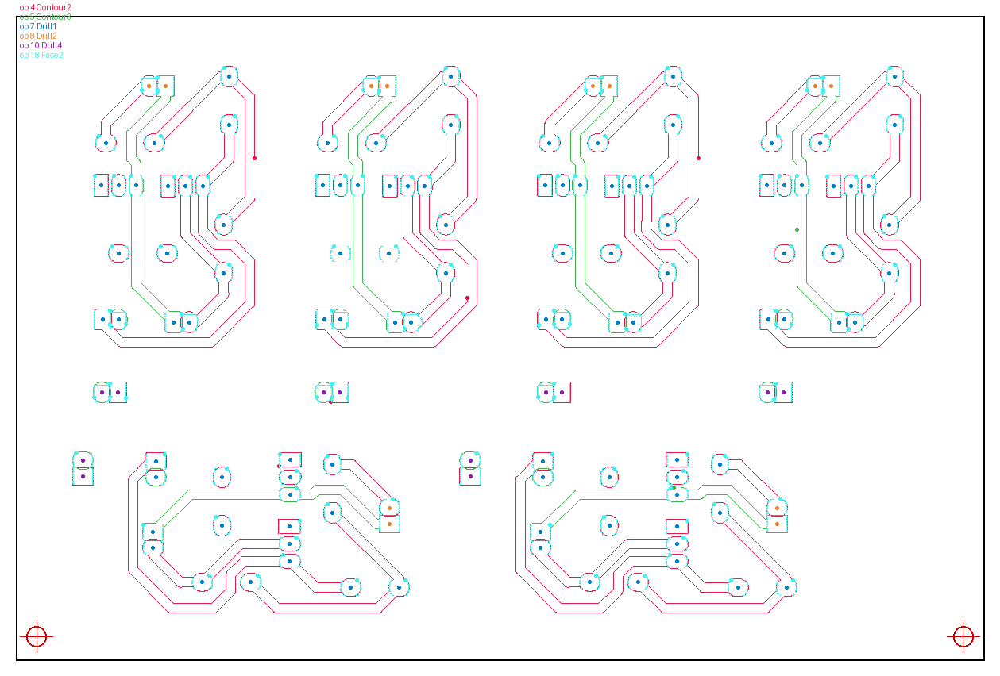

# Lab example: Fusion 360 setup and demo panel

This directory holds the lab's calibrated Fusion 360 CAM setup: `Pcb DXF's amd copper plate.f3z`. It contains a demo panel of 6 small boards that the lab already milled. Each board and its fab outputs must fit this setup. The owner committed the file. The Fusion exports of the owner are in `fusion_export/` (see below).

## Facts read from the file

Source: the CAM XML (`Toolpath/Iron.Document/theIronDoc.irondoc`), the toolpath float data and `Iron.Machine/1.mch`. Status: verified by reading the file, except where a line says "not in the file".

| Item | Value |
| --- | --- |
| Machine | Makera Carvera, 3 axes, post `Carvera.cps`, tool changer, air coolant |
| Stock | 152.4 x 101.6 mm (4 in x 6 in). X runs along the long side. The Fusion model is 1.4859 mm thick. The real blank is Kepro P22-465G, 2 oz, 1.57 mm (owner, 2026-11-12) |
| Dowel holes | 2 holes, diameter 4.191 mm (0.165 in) for 4.0 mm pins. Centers at (3.2766, 3.81) and (149.1234, 3.81) mm from the stock lower-left corner. They are 145.8468 mm apart on one line along a long side, 3.2766 mm from each short end |
| How the dowels were found | The Bore1 toolpath floats are +-72.9234 mm in X and -46.99 mm in Y from the stock center. The helix radius is 0.508 mm for the 3.175 mm tool: (4.191 - 3.175) / 2 |
| Setup A | Bore1 cuts the dowel holes with a 1/8 in (3.175 mm) flat end mill, through the stock (-0.02 mm), 10000 rpm. This is the only end mill in the file |
| Setup B (top) | WCS origin = dowel 1 center. Operations: 2D contour isolation, drills, Face2 |
| Setup C (bottom) | WCS origin = dowel 2 center. The stock is flipped about its short (Y) axis, so the two dowels swap places. Isolation contours and Face3 |
| Isolation | One contour pass, depth 0.08 mm below the contour, compensation left. Tool: chamfer mill "0.1mm Tip Engraving" with tip 0.2 mm and taper 30 (Fusion value), 12000 rpm, feed 500, plunge 200 |
| Drills | 0.9, 1.0 and 1.1 mm. Chip breaking, 10000 rpm, through (-0.02 mm) |
| Face2 | 0.3 mm tip, 15 degree "solder mask removal" tool, stepover 0.2 mm |
| Drill map | The preview shows a "Drill Map" legend. The lab makes the holes from the KiCad drill-map DXF |

Owner statements (PR #3, 2026-11-12): the blank is even (depth error 0); the drill bits are 0.1 to 2.0 mm in 0.1 mm steps; dowel holes are always made; B.Cu is not mirrored.

Not in the file: the post-processed `.cnc` code (the post `Carvera.cps` is not received, owner 2026-11-15). The Fusion exports below close the other open items (taper reading, tool library, dowel check).

## What follows for a board

- A hole between 2.0 mm and 3.3 mm cannot be made. The largest drill is 2.0 mm and the only end mill is 3.175 mm. `milled_hole_min` is 3.3 mm (assumed: tool + 0.125 mm).
- The cut depth is 0.08 mm on 0.070 mm copper: the margin is 0.01 mm on an even blank. MILL-DEPTH passes with error 0. A real depth error larger than 0.01 mm leaves copper in the isolation cut. The lab tech accepts this margin (2026-11-13) and adds a second, deeper pass in the CAM file if necessary.
- The board outline must fit the stock and stay clear of the dowel holes. Each board records its frame on the stock in its own fab README.

## Fusion exports (owner, Win11, 2026-11-15)

Source: PR #3 comment of 2026-11-15 (`pcb_export.zip` and 7 screenshots; the owner replaced the zip at 21:48 with the setup sheets of all setups). Files are in `fusion_export/`. Fusion CAM 2706.1.17. The setup sheets and the sketch DXFs use inches.

| File | Content |
| --- | --- |
| `setup_sheet_all.htm` | All 10 operations of the 3 setups in one sheet (Fusion names the job "Setup A"): Bore1, 2D Contour2, 2D Contour3, Drill1, Drill2, Drill4, Face2, 2D Contour4, 2D Contour5, Face3. Tools T2, T4, T5. Estimated time 58 min 51 s |
| `setup_sheet_A.htm` | Setup A: Bore1 only (T4 end mill, 10000 rpm, feed 1000 mm/min, min Z -0.059 in = through the stock). WCS origin = stock center, Z0 = stock top (stock from (-3, -2, -0.059) to (3, 2, 0) in). Estimated time 20 s |
| `setup_sheet_B.htm` | Setup B (top): 2D Contour2, 2D Contour3 (T2, min Z 0.055 in), Drill1 0.9 mm (min Z -0.011 in), Drill2 1.0 mm (min Z -0.013 in), Drill4 1.1 mm (min Z -0.001 in), drills at 10000 rpm and 100 mm/min, Face2 (T5). WCS origin = dowel center, Z0 = stock bottom (stock from (-0.129, -0.15, 0) to (5.871, 3.85, 0.059) in). Estimated time 36 min 14 s |
| `setup_sheet_C.htm` | Setup C (bottom): 2D Contour4, 2D Contour5 (T2, min Z 0.055 in), Face3 (T5, 6000 rpm). WCS origin = dowel center, Z0 = stock bottom. Estimated time 22 min 17 s |
| `tool_library.json` | Tool library of the document: T2 chamfer mill "0.1mm Tip Engraving Metal" (3.175 mm shank, tip 0.2 mm, taper 30), T4 flat end mill "12mm Flute End Mill Metal" (3.175 mm, flute 12 mm), drills 0.9, 1.0 and 1.1 mm (118 degrees), T5 chamfer mill "0.3mm Tip Solder Mask Removal" (tip 0.3 mm, taper 15) |
| `sketch1_stock_top.dxf` | Stock rectangle 6 x 4 in, origin at the lower-left corner |
| `sketch10_dowels.dxf` | 2 dowel circles, radius 0.0825 in (diameter 4.191 mm), centers (0.129, 0.15) and (5.871, 0.15) in, and a line between them |
| `sketch2_stock_bottom.dxf` | The same stock and dowels in the bottom frame: x and y negated, dowels at (-0.129, -0.15) and (-5.871, -0.15) in, and a dashed line at x = -3 in (the flip axis) |
| `measure_dowels.png` | Fusion Measure: hole diameter 0.165 in, centers (5.871, 0.15) and (0.129, 0.15) in, distance 5.742 in |
| `tool2_vbit_geometry.png`, `tool2_vbit_feeds.png` | T2 drawing and values: taper angle 30 degrees, "Inclusive angle" empty, 12000 rpm, feed 500, plunge 200, ramp 300 mm/min, stepdown 0.1 mm |
| `tool4_endmill_geometry.png`, `tool4_endmill_feeds.png` | T4 drawing and values: 12000 rpm, feed 500, plunge 200, stepdown 0.2 mm |
| `tool5_mask_geometry.png`, `tool5_mask_feeds.png` | T5 drawing and values: taper angle 15 degrees, 6000 rpm, feed 400, stepover 0.2 mm |

Results:
- **Taper is the angle per side.** In the T2 drawing, the cone is about 2.6 mm long (scale bar 5 mm). It goes from the 0.2 mm tip to the 3.175 mm shank. That is 30 degrees per side. A 30 degree included cone needs about 5.6 mm. The T5 drawing agrees (15 degrees per side). So T2 is a 60 degree included V-bit. Its cut is 0.292 mm wide at 0.08 mm depth. The 30 degree included reading is removed from `milling.toml`.
- **Stock and dowels are confirmed.** The Fusion values agree with the values from the `.f3z`. In inches: 0.129 in = 3.2766 mm, 0.15 in = 3.81 mm, 5.871 in = 149.1234 mm, 0.165 in = 4.191 mm.
- **Tool numbers:** T2 isolation, T4 end mill, T5 solder mask removal.
- **Difference:** the T4 values in the tool library say 12000 rpm. The Bore1 operation in the `.f3z` uses 10000 rpm. The operation value applies to the cut.
- **Z origins differ.** Setup A has Z0 at the stock top. Setups B and C have Z0 at the stock bottom (the spoilboard face). The isolation depth is then top (0.0585 in) minus 0.055 in, about 0.08 mm at the 0.001 in rounding of the sheets.
- **One tool number for the end mill and the drills.** The sheets show T4 for the end mill and for the 0.9, 1.0 and 1.1 mm drills. So each drill change is a manual change at the same tool number. The post-processed code will show how the Carvera asks for it.
- **Face2 and Face3 cut at Z = stock top** (min Z 0.059 in). They remove material above the copper only, for example solder mask paint. This agrees with the inference below.
- **Still open:** the NC code (needs `Carvera.cps`).

## How to read the file again

The `.f3z` is a zip that holds a `.f3d`. The `.f3d` is a zip too, but its members use zstd (zip method 93). Python `zipfile` cannot read method 93. Read the raw member bytes with the zip offsets and decompress them with the host `zstd -d`. This is a one-time analysis step, not a repo tool.

```python
import io, os, struct, subprocess, sys, zipfile
src, out = sys.argv[1], sys.argv[2]            # the .f3z file, an empty output directory
outer = zipfile.ZipFile(src)
f3d = outer.read([n for n in outer.namelist() if n.endswith(".f3d")][0])
z = zipfile.ZipFile(io.BytesIO(f3d))
for i in z.infolist():
    if i.is_dir():
        continue
    dst = os.path.join(out, i.filename)
    os.makedirs(os.path.dirname(dst), exist_ok=True)
    if i.compress_type == 93:                  # zstd
        n, m = struct.unpack("<HH", f3d[i.header_offset + 26:i.header_offset + 30])
        start = i.header_offset + 30 + n + m
        data = subprocess.run(["zstd", "-d", "-c"], input=f3d[start:start + i.compress_size],
                              capture_output=True, check=True).stdout
    else:
        data = z.read(i)
    open(dst, "wb").write(data)
```

The file gives 61 members. These are readable: `Toolpath/Iron.Document/theIronDoc.irondoc` (CAM XML: setups, operations, tools, stock), `Iron.Machine/1.mch` (JSON), the message logs and the PNG previews. The toolpath data holds float32 XYZ values. The BREP (`.smb`) and bulk-stream members are proprietary and stay unread. Put the extracted files in a scratch directory, not in the repository.

## Demo toolpaths (decoded, Opus cross-check 2026-11-13)

A worker decoded the `.toolpath` float data (tagged float32 records: points, 2D arcs, helices). Only the results below are kept, because each one matches a fact read separately from the CAM XML.

| Result | Cross-check |
| --- | --- |
| Bore1: 2 helices around (+-72.9234, -46.99) from the stock center, radius 0.508 mm, down to 1.506 mm below the top | Dowel position and 4.191 mm hole for the 3.175 mm tool; through-cut -0.02 mm on the 1.4859 mm model |
| Drills: 108 hits at 0.9 mm, 12 at 1.0 mm, 12 at 1.1 mm | Same counts as the hole circles in the Fusion sketch |
| Drill depth: 0.9 mm to -1.776, 1.0 mm to -1.806, 1.1 mm to -1.506 below the top | -1.4859 - 0.02 - tip length (118 degree tip) for 0.9 and 1.0 mm; Drill4 has `drillTipThroughBottom = false`, so no tip length |
| Isolation (setups B and C): one pass at -0.08 mm around each merged trace-and-pad outline, no extra passes | Contour depth -0.08 mm in the CAM XML |
| Setup C paths match setup B after a mirror about the stock short axis (face extents agree within 0.03 mm) | Setup C WCS: dowel 2, Z flipped |



Inference, not proven: Face2 and Face3 cut at the stock top, only on pad-sized areas, with the "solder mask removal" tool. So the lab probably paints UV solder mask and then mills it off the pads. Ask the lab tech before relying on this.
