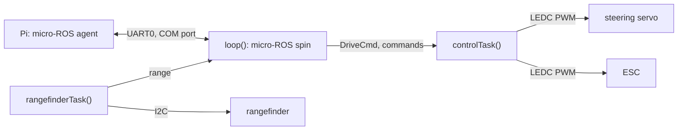

# firmware/: ESP32-S3 firmware

The real-time layer of the car. The ESP32-S3-N16R8 makes the servo and ESC PWM, runs the failsafe, reads the rangefinder and talks to the Pi over micro-ROS. It supplies power to nothing (`docs/invariants.md`).

| Path | Content |
|---|---|
| [`esp32/`](esp32/) | PlatformIO project, env `esp32s3`: [`src/main.cpp`](esp32/src/main.cpp), [`include/pins.h`](esp32/include/pins.h) (pin map owner), `rccar.meta` |
| [`esp32/extra_packages/`](esp32/extra_packages/) | Copy of `ros2_ws/src/rccar_msgs` for the micro-ROS build. Do not edit |

- Reference (build, tasks, limits, command grammar): [docs/firmware/README.md](../docs/firmware/README.md).
- Build: `make build`. Upload: `make flash` (ESC off, car stack down).
