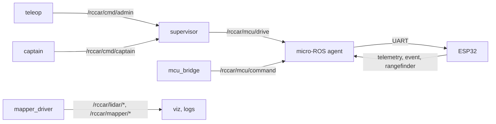

# ros2_ws/: ROS 2 workspace

The ROS 2 Jazzy packages that run on the Pi in docker: the safety supervisor, the ESP32 bridge, the sensor drivers and the operator tools. `make ros-image` builds them into the image `rccar-ros:local`. `make car-up` starts them.

| Package | Role |
|---|---|
| [`rccar_msgs`](src/rccar_msgs/) | Interface contract: DriveCmd, Telemetry, McuEvent, McuCommand, Reset and others |
| [`rccar_supervisor`](src/rccar_supervisor/) | Safety authority: arbitration, latched stop, only publisher of `/rccar/mcu/drive` |
| [`rccar_mcu_bridge`](src/rccar_mcu_bridge/) | Lifecycle node: typed services over McuCommand, tuning push to the ESP32 |
| [`rccar_drivers`](src/rccar_drivers/), [`rccar_description`](src/rccar_description/) | Lidar driver (Mapper over Wi-Fi/TCP), URDF and TF |
| [`rccar_bringup`](src/rccar_bringup/) | Launch files, `tuning.toml` to ROS parameters |
| [`rccar_teleop`](src/rccar_teleop/), [`rccar_calibration`](src/rccar_calibration/) | Keyboard teleop, calibration, bench and sensor monitor tools |
| [`repos/`](repos/) | Third-party ROS sources (vcstool manifest) |

- Topics and QoS: [docs/interfaces/](../docs/interfaces/sensor_contract.md). Deploy: [docs/deploy.md](../docs/deploy.md).
- Tests: `make ros-test` (no hardware).
