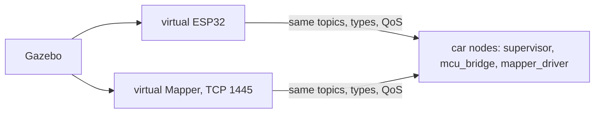

# simulation/: Gazebo simulation (scaffold)

The simulation of the car. Today it is in the separate repo [racecar-sim](https://github.com/gvo27/racecar-sim) (move: ADR 0001). The sim replaces the ESP32 and the lidar with virtual devices. The real car nodes run unchanged.

| Path | Content |
|---|---|
| [`gazebo/`](gazebo/) | Worlds, models and the gz bridge config (empty now) |

- Hardware boundary that the sim must copy: [docs/interfaces/sensor_contract.md](../docs/interfaces/sensor_contract.md).
- Car-side sim findings and open items: [docs/sim/README.md](../docs/sim/README.md).
- `COLCON_IGNORE` keeps this folder out of the ROS 2 build until the sim packages move in.
